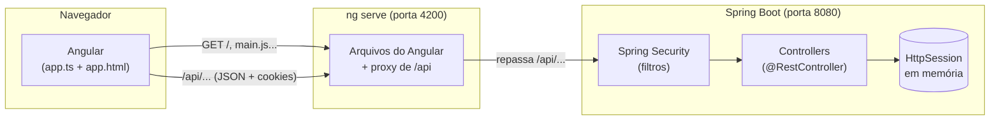
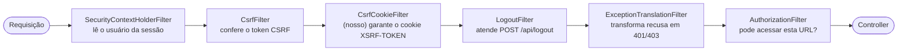
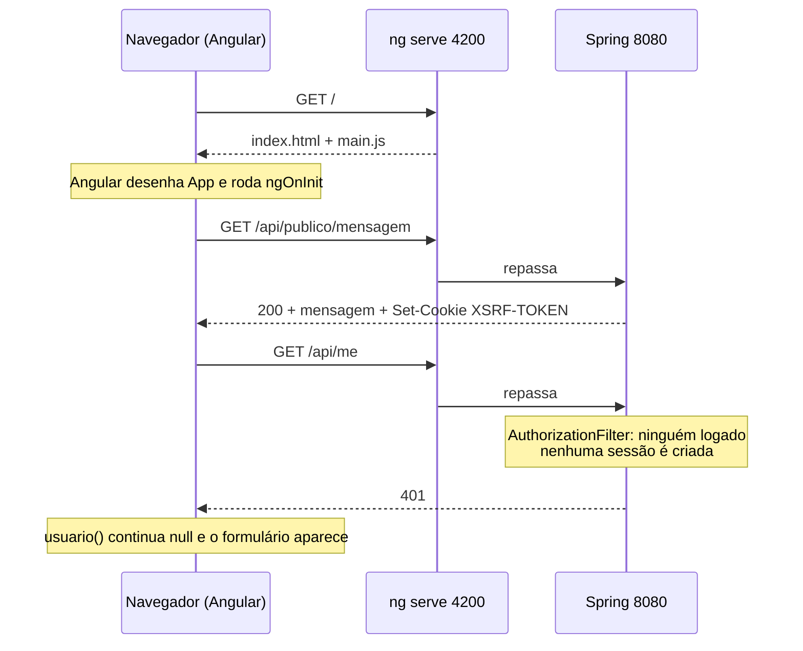
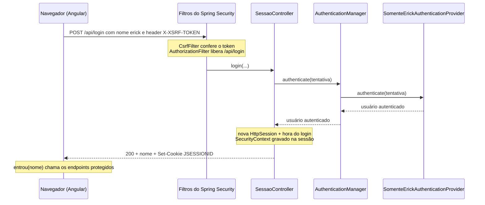
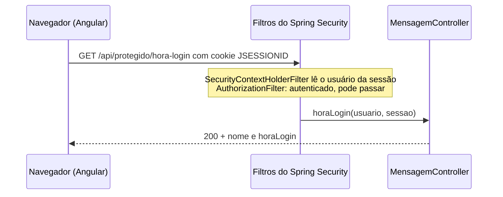

# Curso: login por sessão com Angular e Spring Boot

> Escrito para quem já conhece **Java, JSF e WildFly** e nunca mexeu com Angular nem com Spring Boot.
> O curso explica o código **desta branch**, arquivo por arquivo e anotação por anotação.
> Sempre que der, a explicação compara com o que você já conhece.

## Sumário

- [Módulo 0: Como rodar e como estudar](#módulo-0-como-rodar-e-como-estudar)
- [Módulo 1: A arquitetura em uma página](#módulo-1-a-arquitetura-em-uma-página)
- [Módulo 2: O backend (Spring Boot)](#módulo-2-o-backend-spring-boot)
  - [2.1 O projeto Maven](#21-o-projeto-maven-pomxml)
  - [2.2 A classe principal](#22-a-classe-principal-backendapplication)
  - [2.3 Injeção de dependência e beans](#23-injeção-de-dependência-e-beans)
  - [2.4 Controllers REST](#24-controllers-rest)
  - [2.5 UppercaseController](#25-uppercasecontroller)
  - [2.6 MensagemController](#26-mensagemcontroller)
  - [2.7 SessaoController](#27-sessaocontroller-o-login)
  - [2.8 Spring Security](#28-spring-security)
  - [2.9 SomenteErickAuthenticationProvider](#29-somenteerickauthenticationprovider-quem-pode-entrar)
  - [2.10 Testes](#210-testes)
- [Módulo 3: O frontend (Angular)](#módulo-3-o-frontend-angular)
  - [3.1 Ferramentas](#31-ferramentas-node-npm-e-angular-cli)
  - [3.2 Como a página nasce](#32-como-a-página-nasce)
  - [3.3 O componente App](#33-o-componente-app)
  - [3.4 O template](#34-o-template-apphtml)
  - [3.5 Falando com o backend](#35-falando-com-o-backend-httpclient)
  - [3.6 O proxy](#36-o-proxy-proxyconfjson)
- [Módulo 4: Os fluxos completos, passo a passo](#módulo-4-os-fluxos-completos-passo-a-passo)
- [Módulo 5: Códigos HTTP usados](#módulo-5-códigos-http-usados)
- [Módulo 6: Exercícios](#módulo-6-exercícios)
- [Apêndice: dicionário JSF → este projeto](#apêndice-dicionário-jsf--este-projeto)

---

## Módulo 0: Como rodar e como estudar

### Rodando

São **dois processos**, cada um num terminal:

```bash
cd backend
./mvnw spring-boot:run
```

```bash
npm install
ng serve
```

No Windows, o primeiro é `.\mvnw.cmd spring-boot:run`. Abra `http://localhost:4200/` e entre com o nome `erick`.

Para rodar os testes do backend:

```bash
cd backend
./mvnw test
```

### Estudando pela história do git

Cada commit acrescenta **uma** ideia. Ler os commits em ordem é um bom jeito de seguir o curso:

```bash
git log --reverse --oneline
git show <hash>
```

A lista comentada dos commits está no [README](README.md#ordem-sugerida-para-estudar-os-commits). Este curso explica o **estado final**.

---

## Módulo 1: A arquitetura em uma página

### A grande diferença em relação ao JSF

No JSF, um único `.war` faz tudo. O servidor monta o HTML de cada página, guarda o estado da tela (ViewState) e os managed beans. O navegador só exibe o resultado.

Aqui são **duas aplicações separadas**, que só conversam por HTTP + JSON:

| | Frontend | Backend |
|---|---|---|
| Tecnologia | Angular (TypeScript) | Spring Boot (Java 17) |
| Pasta | `src/` | `backend/` |
| Onde roda | **No navegador** | No servidor (Tomcat embutido) |
| Porta em desenvolvimento | 4200 (`ng serve`) | 8080 |
| O que entrega | HTML, CSS e JavaScript, uma vez só | JSON, a cada chamada `/api/...` |
| Equivalente JSF | As páginas `.xhtml` + a parte "visual" dos managed beans | Os managed beans com regra de negócio, como se fossem recursos JAX-RS |



1. O navegador abre `http://localhost:4200/`. O `ng serve` entrega um HTML quase vazio e um JavaScript, que é o Angular.
2. O Angular desenha a tela **no navegador**. Daqui em diante, a página nunca mais é recarregada pelo servidor.
3. Quando precisa de dados, o Angular faz chamadas HTTP para `/api/...`. O `ng serve` repassa essas chamadas para o Spring na porta 8080 (veja [3.6](#36-o-proxy-proxyconfjson)).
4. O Spring passa a requisição pela cadeia de filtros do Spring Security, que decide se ela pode seguir. Depois o controller responde em JSON.
5. O login fica numa `HttpSession` comum, identificada pelo cookie `JSESSIONID`, igual ao que você conhece do WildFly.

### Consequências práticas

- **F5 apaga a memória da tela.** A sessão continua no servidor, mas o Angular recomeça do zero. Por isso, ao abrir, a tela pergunta ao backend quem está logado (`GET /api/me`).
- **O servidor não sabe qual tela está aberta.** Ele só vê chamadas HTTP soltas. Não existe ViewState nem árvore de componentes no servidor.
- **A proteção contra CSRF precisa ser feita de propósito.** No JSF o ViewState já cumpre esse papel. Aqui é o Spring Security, com um token próprio (veja [2.8](#28-spring-security)).

---

## Módulo 2: O backend (Spring Boot)

Arquivos em `backend/src/main/java/com/example/backend/`:

| Arquivo | Papel |
|---|---|
| `BackendApplication.java` | Classe com `main`: liga tudo |
| `UppercaseController.java` | `POST /api/protegido/uppercase`: nome em maiúsculas |
| `MensagemController.java` | `GET /api/publico/mensagem` e `GET /api/protegido/hora-login` |
| `SessaoController.java` | `POST /api/login` e `GET /api/me` |
| `SecurityConfig.java` | Regras de acesso, logout e CSRF |
| `SomenteErickAuthenticationProvider.java` | Decide quem pode entrar |

E `backend/src/main/resources/application.properties`, que é a configuração (equivale a uma mistura de `standalone.xml` e `web.xml`).

### 2.1 O projeto Maven (`pom.xml`)

É um projeto Maven normal, com três diferenças:

```xml
<parent>
    <groupId>org.springframework.boot</groupId>
    <artifactId>spring-boot-starter-parent</artifactId>
    <version>4.1.2</version>
</parent>
```

- **`spring-boot-starter-parent`**: um POM pai que já define as versões de centenas de bibliotecas compatíveis entre si. Por isso as dependências abaixo não têm `<version>`. Lembra um BOM do Jakarta EE, mas cobre também plugins e configuração de build.

```xml
<dependency>
    <groupId>org.springframework.boot</groupId>
    <artifactId>spring-boot-starter-webmvc</artifactId>
</dependency>
<dependency>
    <groupId>org.springframework.boot</groupId>
    <artifactId>spring-boot-starter-security</artifactId>
</dependency>
```

- **Starters**: dependências "pacote". O `spring-boot-starter-webmvc` traz Spring MVC, Jackson (JSON) e **um Tomcat embutido**. O `spring-boot-starter-security` traz o Spring Security. Os `...-test` trazem JUnit 5, AssertJ, MockMvc e utilitários de teste de segurança.
- **`spring-boot-maven-plugin`**: permite `./mvnw spring-boot:run` e gera um `.jar` executável (`java -jar backend.jar`). **Não há `.war` nem deploy:** o servidor está dentro da aplicação, e não o contrário.
- **`mvnw` / `mvnw.cmd`**: o *Maven Wrapper*. Ele baixa a versão certa do Maven na primeira execução, então ninguém precisa ter Maven instalado.

### 2.2 A classe principal (`BackendApplication`)

```java
@SpringBootApplication
public class BackendApplication {
    public static void main(String[] args) {
        SpringApplication.run(BackendApplication.class, args);
    }
}
```

- **`@SpringBootApplication`** junta três anotações:
  - `@Configuration`: esta classe pode declarar beans (veja 2.3).
  - `@ComponentScan`: procura classes anotadas (`@RestController`, `@Component`, `@Configuration`...) **neste pacote e nos subpacotes**, e cria uma instância de cada. É parecido com o CDI descobrindo beans num `.war`.
  - `@EnableAutoConfiguration`: o "mágico" do Spring Boot. Olha o que há no classpath e configura sozinho. Viu Spring MVC? Sobe um Tomcat na porta 8080. Viu Jackson? Converte objetos em JSON. Viu Spring Security? Liga os filtros de segurança.
- **`SpringApplication.run(...)`** cria o contêiner do Spring (o *ApplicationContext*, o equivalente ao contêiner CDI), sobe o Tomcat e fica esperando requisições. No WildFly o servidor já estava rodando e você fazia deploy; aqui o `main` **é** o servidor.

### 2.3 Injeção de dependência e beans

**Bean** é qualquer objeto que o Spring cria e gerencia, como um bean CDI. Neste projeto os beans nascem de dois jeitos:

1. **Classe anotada, achada pelo `@ComponentScan`**: `@RestController` (os controllers), `@Component` (o provider) e `@Configuration` (o `SecurityConfig`). Por padrão cada bean é **singleton**: uma instância para a aplicação inteira, como `@ApplicationScoped`.
2. **Método `@Bean` dentro de uma classe `@Configuration`**: o retorno do método vira um bean. É parecido com um método `@Produces` do CDI.

```java
@Bean
AuthenticationManager authenticationManager(SomenteErickAuthenticationProvider provider) {
    return new ProviderManager(provider);
}
```

Os **parâmetros** de um método `@Bean` são injetados pelo Spring. Aqui ele procura o bean do tipo `SomenteErickAuthenticationProvider` e o passa.

**Injeção pelo construtor**, como no `SessaoController`:

```java
private final AuthenticationManager authenticationManager;

public SessaoController(AuthenticationManager authenticationManager) {
    this.authenticationManager = authenticationManager;
}
```

Quando a classe tem **um único construtor**, o Spring o usa automaticamente e injeta os parâmetros, sem precisar de `@Autowired` ou `@Inject`. É o estilo recomendado, porque o campo pode ser `final` e o teste pode criar o objeto com `new`.

### 2.4 Controllers REST

Um controller REST é o equivalente a um recurso JAX-RS. As anotações usadas:

| Anotação | O que faz | Equivalente JAX-RS |
|---|---|---|
| `@RestController` | Marca a classe como controller cujos métodos devolvem **dados** (JSON), não páginas | `@Path` na classe + `@Produces(JSON)` |
| `@RequestMapping("/api")` | Prefixo de URL de todos os métodos da classe | `@Path("/api")` na classe |
| `@GetMapping("/me")` | Este método atende `GET /api/me` | `@GET @Path("/me")` |
| `@PostMapping("/login")` | Este método atende `POST /api/login` | `@POST @Path("/login")` |
| `@RequestBody` | Converte o JSON do corpo da requisição no parâmetro | O parâmetro "solto" do método JAX-RS |

**Entrada e saída em JSON com `record`s**:

```java
public record LoginRequest(String name) { }
public record UsuarioResponse(String name) { }
```

Um `record` (Java 16+) é uma classe imutável com construtor, getters, `equals` e `toString` gerados. O **Jackson** converte o JSON `{ "name": "erick" }` em `new LoginRequest("erick")` e o retorno `new UsuarioResponse("erick")` em `{ "name": "erick" }`. Os nomes dos campos do JSON são os nomes dos componentes do record.

**Parâmetros que o Spring injeta sozinho**: além do `@RequestBody`, um método de controller pode pedir objetos da requisição, e o Spring passa automaticamente:

| Parâmetro | O que vem |
|---|---|
| `HttpServletRequest`, `HttpServletResponse` | Os objetos de servlet de sempre (pacote `jakarta.servlet`) |
| `HttpSession` | A sessão (é criada se ainda não existir) |
| `Authentication` | O usuário logado, vindo do Spring Security (veja 2.8) |

**`ResponseEntity<T>`**: quando o método precisa escolher o código HTTP, ele devolve um `ResponseEntity`. Sem isso, a resposta é sempre 200 com o objeto como JSON.

```java
return ResponseEntity.badRequest().build();                     // 400, corpo vazio
return ResponseEntity.status(HttpStatus.UNAUTHORIZED).build();  // 401
return ResponseEntity.ok(new UsuarioResponse(nome));            // 200 + JSON
```

### 2.5 `UppercaseController`

```java
@PostMapping("/protegido/uppercase")
public NameResponse uppercase(@RequestBody NameRequest request) {
    String name = request.name() == null ? "" : request.name();
    return new NameResponse(name.toUpperCase(Locale.ROOT));
}
```

É o controller mais simples: recebe `{ "name": "erick" }` e devolve `{ "result": "ERICK" }`. Repare que **não há nenhuma linha de segurança aqui**. Ele só é protegido porque o caminho começa com `/api/protegido`, e o Spring Security exige login para tudo que não foi liberado (veja 2.8).

`Locale.ROOT` evita surpresas com idiomas. Em turco, por exemplo, `"i".toUpperCase()` não vira `"I"`.

### 2.6 `MensagemController`

```java
@GetMapping("/publico/mensagem")
public MensagemResponse mensagem() {
    return new MensagemResponse("Olá do backend! ...");
}
```

**Público**: o caminho `/api/publico/**` foi liberado no `SecurityConfig`, então qualquer um chama, logado ou não.

```java
@GetMapping("/protegido/hora-login")
public HoraLoginResponse horaLogin(Authentication usuario, HttpSession sessao) {
    return new HoraLoginResponse(usuario.getName(),
            (Instant) sessao.getAttribute(SessaoController.ATRIBUTO_HORA_LOGIN));
}
```

**Protegido**: se o método está executando, é porque o Spring Security já deixou passar. Então `usuario` e `sessao` sempre existem aqui.

- `usuario.getName()` vem do Spring Security, e é o nome com que a pessoa entrou.
- A hora do login é um atributo **nosso** na `HttpSession`, gravado no login. É o `session.setAttribute` que você já usa em servlets.
- O `Instant` vira texto no padrão ISO-8601 no JSON, por exemplo `"2026-11-12T20:00:00Z"`, sempre em UTC. Quem converte para o fuso do usuário é o Angular, na hora de exibir.

### 2.7 `SessaoController`: o login

Este é o coração do projeto. O método de login, linha a linha:

```java
@PostMapping("/login")
public ResponseEntity<UsuarioResponse> login(@RequestBody LoginRequest request,
        HttpServletRequest http, HttpServletResponse response) {
```

**1. Validar a entrada.** Nome vazio é erro do cliente, então a resposta é 400:

```java
    String nome = request.name() == null ? "" : request.name().trim();
    if (nome.isEmpty()) {
        return ResponseEntity.badRequest().build();
    }
```

**2. Pedir ao Spring Security para autenticar.** O controller **não decide** quem entra. Ele monta uma *tentativa* (`unauthenticated`) e entrega ao `AuthenticationManager`. Se a tentativa for recusada, vem uma exceção, e a resposta é 401:

```java
    Authentication usuario;
    try {
        usuario = authenticationManager.authenticate(
                UsernamePasswordAuthenticationToken.unauthenticated(nome, null));
    }
    catch (AuthenticationException recusado) {
        return ResponseEntity.status(HttpStatus.UNAUTHORIZED).build();
    }
```

`UsernamePasswordAuthenticationToken` é a classe do Spring Security para "usuário + senha". Aqui a senha é `null`, porque não há senha.

**3. Criar uma sessão nova.** Se já existia uma sessão, ela é descartada e outra é criada. Isso evita o ataque de *session fixation*, em que alguém faz a vítima usar um `JSESSIONID` que o atacante já conhece:

```java
    HttpSession antiga = http.getSession(false);   // false: não cria se não existir
    if (antiga != null) {
        antiga.invalidate();
    }
    HttpSession sessao = http.getSession(true);    // true: cria uma nova
    sessao.setAttribute(ATRIBUTO_HORA_LOGIN, Instant.now());
```

Quando a sessão é criada, o Tomcat devolve na resposta o cabeçalho `Set-Cookie: JSESSIONID=...; HttpOnly`. `HttpOnly` significa que o JavaScript da página **não consegue ler** esse cookie, só o navegador o envia.

**4. Guardar o usuário autenticado na sessão:**

```java
    SecurityContext context = SecurityContextHolder.createEmptyContext();
    context.setAuthentication(usuario);
    SecurityContextHolder.setContext(context);
    contextRepository.saveContext(context, http, response);
```

- **`SecurityContext`**: a "ficha" de quem está logado. Ela guarda um `Authentication`.
- **`SecurityContextHolder`**: onde o Spring Security guarda a ficha **durante a requisição atual**. É um `ThreadLocal`: cada requisição (cada thread do Tomcat) tem a sua.
- **`HttpSessionSecurityContextRepository`**: grava a ficha **na `HttpSession`**, no atributo `SPRING_SECURITY_CONTEXT`. Nas próximas requisições, um filtro do Spring Security (`SecurityContextHolderFilter`) lê a ficha da sessão e a coloca de volta no `SecurityContextHolder`. É isso que faz o login "durar" entre requisições.

**5. Responder com o nome:**

```java
    return ResponseEntity.ok(new UsuarioResponse(usuario.getName()));
```

**Quem está logado?**

```java
@GetMapping("/me")
public UsuarioResponse me(Authentication usuario) {
    return new UsuarioResponse(usuario.getName());
}
```

O Spring pega o `Authentication` do `SecurityContextHolder` e o passa como parâmetro. Se ninguém estiver logado, o Spring Security responde 401 **antes** de chegar aqui, e por isso não há `if`.

**E o logout?** Não existe método de logout no controller. Quem atende `POST /api/logout` é um filtro do próprio Spring Security (veja a seguir).

### 2.8 Spring Security

#### O que é

O Spring Security é uma **cadeia de filtros de servlet** (`jakarta.servlet.Filter`) que roda **antes** dos controllers. Cada filtro tem uma tarefa. Os que importam aqui, na ordem em que rodam:



No JSF/WildFly, o equivalente é a segurança declarativa do contêiner (`<security-constraint>` no `web.xml`, realms do Elytron), ou um `Filter` que você escreveria à mão.

#### `SecurityConfig`

```java
@Configuration
public class SecurityConfig {

    @Bean
    SecurityFilterChain securityFilterChain(HttpSecurity http) throws Exception {
        http
            .authorizeHttpRequests(...)
            .exceptionHandling(...)
            .logout(...)
            .csrf(...)
            .addFilterAfter(...);
        return http.build();
    }
```

- **`@Configuration`**: classe que declara beans (2.3).
- **`SecurityFilterChain`**: o bean que monta a cadeia de filtros. O `HttpSecurity` é um *builder*: cada método configura um pedaço, e `build()` gera a cadeia. As setas `->` são *lambdas* do Java 8: o Spring entrega um configurador, e o código diz o que fazer com ele.

**Quem pode acessar o quê:**

```java
.authorizeHttpRequests(auth -> auth
    .requestMatchers("/api/login", "/api/publico/**", "/error").permitAll()
    .anyRequest().authenticated())
```

- `permitAll()`: liberado para todos. O login precisa ser liberado, senão ninguém conseguiria entrar.
- `/error`: é a URL para onde o Tomcat encaminha quando um controller lança exceção (por exemplo, JSON malformado). Se ela não fosse liberada, um erro 400 viraria um 401 confuso.
- `anyRequest().authenticated()`: **todo o resto exige login.** Por isso o `UppercaseController` não tem nenhuma linha de segurança: ele está protegido por padrão. É mais seguro do que listar o que proteger, porque um endpoint novo já nasce protegido.

**O que acontece quando alguém sem login tenta acessar:**

```java
.exceptionHandling(ex -> ex.authenticationEntryPoint(
        new HttpStatusEntryPoint(HttpStatus.UNAUTHORIZED)))
```

O *entry point* é "o que fazer com quem precisa se autenticar". Num site tradicional, como no JSF, seria redirecionar para a página de login. Aqui é uma API JSON, então a resposta é só um 401, e quem decide mostrar o formulário é o Angular.

**Não criar sessão para quem não está logado:**

```java
.requestCache(cache -> cache.requestCache(new NullRequestCache()))
```

Num site tradicional, quando alguém sem login tenta abrir `/pagina-x`, o Spring guarda essa requisição **na sessão**, redireciona para o login e, depois de entrar, leva a pessoa de volta a `/pagina-x`. É o *request cache*. Numa API isso não serve para nada, porque quem decide para onde ir é o Angular. E tem um efeito ruim: cada chamada recusada criava uma `HttpSession` (e um `JSESSIONID`) para um visitante anônimo, ocupando memória do servidor à toa. O `NullRequestCache` é um cache que não guarda nada.

> Cuidado com a armadilha: `cache.disable()` parece fazer a mesma coisa, mas não faz. Ele só remove o configurador, e o tratamento de erro volta a usar o cache de sessão padrão. Foi preciso um teste contra o servidor real para perceber isso (veja [2.10](#210-testes)).

**Logout:**

```java
.logout(logout -> logout
    .logoutUrl("/api/logout")
    .logoutSuccessHandler(new HttpStatusReturningLogoutSuccessHandler(HttpStatus.NO_CONTENT)))
```

O `LogoutFilter` intercepta `POST /api/logout`, invalida a `HttpSession`, limpa o `SecurityContext` e responde 204 (sucesso, sem corpo). A requisição nem chega a um controller.

**CSRF:**

```java
.csrf(csrf -> csrf.spa())
.addFilterAfter(new CsrfCookieFilter(), CsrfFilter.class);
```

O problema: o navegador envia o `JSESSIONID` **automaticamente**, para qualquer requisição a `localhost:4200`, inclusive as disparadas por **outro site** aberto em outra aba. Sem proteção, um site malicioso poderia fazer o navegador de um usuário logado enviar um POST para cá. Esse ataque se chama *Cross-Site Request Forgery* (CSRF).

A solução, chamada *double submit cookie*:

1. O servidor gera um token aleatório e o grava num cookie `XSRF-TOKEN`. Esse cookie **não** é `HttpOnly`, de propósito, para o JavaScript da página poder lê-lo.
2. Em todo POST/PUT/DELETE, o `CsrfFilter` exige o mesmo valor no **header** `X-XSRF-TOKEN`. Se faltar ou não bater, a resposta é 403.
3. Um site de outra origem **não consegue ler** cookies de `localhost:4200`, então não consegue montar o header.

`csrf.spa()` configura exatamente esse esquema, no formato que o Angular espera. GET não precisa do token, porque GET não deve alterar nada.

O `CsrfCookieFilter` é um filtro **nosso**, uma classe interna do `SecurityConfig`:

```java
static final class CsrfCookieFilter extends OncePerRequestFilter {
    @Override
    protected void doFilterInternal(HttpServletRequest request, HttpServletResponse response,
            FilterChain filterChain) throws ServletException, IOException {
        CsrfToken csrfToken = (CsrfToken) request.getAttribute(CsrfToken.class.getName());
        if (csrfToken != null) {
            csrfToken.getToken();
        }
        filterChain.doFilter(request, response);
    }
}
```

Por economia, o Spring só grava o cookie `XSRF-TOKEN` quando alguém **lê** o token. Este filtro lê o token em toda requisição, para garantir que o navegador já tenha o cookie antes do primeiro POST (o login). `OncePerRequestFilter` é uma classe base do Spring que garante que o filtro rode uma vez só por requisição. Fora isso, é um `Filter` de servlet como os que você já escreveu: faz o seu trabalho e chama `filterChain.doFilter(...)` para seguir adiante.

**O `AuthenticationManager`:**

```java
@Bean
AuthenticationManager authenticationManager(SomenteErickAuthenticationProvider provider) {
    return new ProviderManager(provider);
}
```

É quem o `SessaoController` chama para autenticar. O `ProviderManager` é a implementação padrão: ele pergunta a cada `AuthenticationProvider` da lista se aceita a tentativa. Aqui a lista tem um só.

Um efeito colateral: como existe um `AuthenticationManager` declarado, o Spring Boot **não** cria sozinho o usuário padrão `user` com senha aleatória, que ele cria quando o Spring Security está no classpath e ninguém configurou autenticação.

### 2.9 `SomenteErickAuthenticationProvider`: quem pode entrar

```java
@Component
public class SomenteErickAuthenticationProvider implements AuthenticationProvider {

    static final String USUARIO_PERMITIDO = "erick";

    @Override
    public Authentication authenticate(Authentication tentativa) {
        String nome = tentativa.getName().trim();
        if (!nome.equalsIgnoreCase(USUARIO_PERMITIDO)) {
            throw new BadCredentialsException("Usuário não autorizado");
        }
        return UsernamePasswordAuthenticationToken.authenticated(nome, null, List.of());
    }

    @Override
    public boolean supports(Class<?> tipo) {
        return UsernamePasswordAuthenticationToken.class.isAssignableFrom(tipo);
    }
}
```

- **`@Component`**: "crie um bean desta classe". O `@ComponentScan` a encontra, e ela é injetada no método `authenticationManager` do `SecurityConfig`.
- **`AuthenticationProvider`**: a interface do Spring Security para "conferir credenciais". Equivale a um `IdentityStore` do Jakarta Security ou a um *security realm* do Elytron no WildFly.
- **`authenticate`**: recebe a tentativa. Se aceita, devolve um `Authentication` **autenticado**. Se recusa, lança uma `AuthenticationException` (aqui, a subclasse `BadCredentialsException`).
- **`List.of()`**: a lista de *authorities* (perfis/roles) do usuário. Está vazia, porque não usamos perfis.
- **`supports`**: diz quais tipos de tentativa este provider sabe tratar. O `ProviderManager` só chama `authenticate` se `supports` disser que sim.

Por que separar a regra do controller? Porque, para **exigir senha**, bastaria trocar este provider pelo `DaoAuthenticationProvider` do Spring, com um `UserDetailsService` (que busca o usuário) e um `PasswordEncoder` (que confere a senha com hash), sem mexer no `SessaoController`.

### 2.10 Testes

Ficam em `backend/src/test/java/com/example/backend/` e rodam com `./mvnw test`.

**Testes de integração** (todos os `*ControllerTests`):

```java
@SpringBootTest
@AutoConfigureMockMvc
class SessaoControllerTests {

    @Autowired
    private MockMvc mockMvc;
```

- **`@SpringBootTest`**: sobe a aplicação inteira (todos os beans, inclusive o Spring Security), mas **sem abrir porta**: o Tomcat é simulado.
- **`@AutoConfigureMockMvc`** + **`MockMvc`**: um "navegador falso" que faz requisições direto na aplicação, passando por **todos os filtros**, inclusive os de segurança.
- **`@Autowired`**: injeção num campo. Em teste é comum, porque a classe de teste não tem construtor próprio.
- **`@Test`**: um caso de teste do JUnit 5.

Um teste típico:

```java
mockMvc.perform(post("/api/login").with(csrf())
        .contentType(MediaType.APPLICATION_JSON)
        .content("{\"name\":\"  \"}"))
    .andExpect(status().isBadRequest());
```

Lê-se como uma frase: "faça um POST em `/api/login`, com token CSRF válido, corpo JSON com nome em branco, e espere 400".

| Utilitário | O que faz |
|---|---|
| `.with(csrf())` | Acrescenta um token CSRF válido. Sem ele, todo POST daria 403 |
| `.with(user("Ana"))` | Simula um usuário já logado, sem passar pelo login |
| `.session(sessao)` | Usa uma `MockHttpSession`, uma sessão falsa que o teste controla |
| `jsonPath("$.name")` | Lê um campo do JSON da resposta |

Os testes cobrem os caminhos importantes: 401 sem login, 403 sem token CSRF, 400 com nome vazio, 401 com nome não permitido, e o logout invalidando a sessão.

**Quando o teste falha sem a correção.** Um teste só prova alguma coisa se ele **falhar** quando o problema existe. Ao corrigir a sessão criada sem login, o primeiro teste escrito, com `MockMvc`, falhava antes e **continuava falhando** depois da correção, porque o `MockMvc` mostrava uma sessão que o servidor real não criava. Daí veio o teste com servidor real, que falha sem a correção e passa com ela.

**Teste com servidor real** (`SessaoAnonimaHttpTests`):

```java
@SpringBootTest(webEnvironment = WebEnvironment.RANDOM_PORT)
class SessaoAnonimaHttpTests {

    @LocalServerPort
    private int porta;
```

- **`webEnvironment = RANDOM_PORT`**: desta vez o Tomcat sobe **de verdade**, numa porta livre qualquer, para os testes não brigarem com um backend que já esteja rodando na 8080.
- **`@LocalServerPort`**: injeta o número da porta escolhida.
- O teste usa o `java.net.http.HttpClient` do próprio Java para fazer um `GET /api/me` sem login e confere o cabeçalho `Set-Cookie`: deve vir o `XSRF-TOKEN`, mas **não** o `JSESSIONID`.

Por que não `MockMvc` aqui? Porque no `MockMvc` a requisição é simulada, e uma sessão aparece mesmo quando o servidor real não cria nenhuma. Para perguntas sobre o que realmente vai para o navegador (cookies, cabeçalhos), o teste com servidor real é o confiável. Ele é mais lento, então só vale a pena quando o `MockMvc` não responde à pergunta.

**Teste de unidade** (`SomenteErickAuthenticationProviderTests`): o provider é uma classe Java comum, então o teste só faz `new SomenteErickAuthenticationProvider()` e chama o método, sem subir o Spring. É o tipo de teste mais rápido e simples.

---

## Módulo 3: O frontend (Angular)

### 3.1 Ferramentas: Node, npm e Angular CLI

| Ferramenta | Papel | Equivalente Java |
|---|---|---|
| **Node.js** | Roda JavaScript fora do navegador. Aqui, só para as ferramentas de build | A JVM rodando o Maven |
| **npm** + `package.json` | Baixa dependências (para `node_modules/`) | Maven + `pom.xml` (para `~/.m2`) |
| **TypeScript** | JavaScript com tipos. O navegador não entende TypeScript: ele é compilado para JavaScript | Java → bytecode |
| **Angular CLI** (`ng`) | Compila, serve e gera código | `mvn` + plugins |
| `angular.json` | Configuração do build: arquivo de entrada, estilos, proxy | Seção `<build>` do `pom.xml` |

Comandos:

- `ng serve`: compila em memória, sobe um servidor de desenvolvimento na porta 4200 e **recarrega a página sozinho** quando um arquivo muda.
- `ng build`: gera os arquivos finais em `dist/hello-angular/`: HTML, JS e CSS estáticos, prontos para qualquer servidor web.

### 3.2 Como a página nasce

**`src/index.html`**: a única página HTML do projeto, quase vazia:

```html
<body>
  <app-root></app-root>
</body>
```

`<app-root>` não é uma tag HTML. É o lugar onde o Angular vai desenhar o componente cujo `selector` é `app-root`.

**`src/main.ts`**: o "`main`" do frontend:

```ts
bootstrapApplication(App, appConfig)
  .catch((err) => console.error(err));
```

Ele inicia o Angular, usando `App` como componente raiz e `appConfig` como configuração.

**`src/app/app.config.ts`**: os *providers* da aplicação, ou seja, serviços disponíveis para injeção em qualquer componente:

```ts
export const appConfig: ApplicationConfig = {
  providers: [
    provideBrowserGlobalErrorListeners(), // mostra no console erros não tratados
    provideRouter(routes),                 // navegação entre "páginas" (não usada ainda)
    provideHttpClient()                    // habilita o HttpClient para chamar o backend
  ]
};
```

**`src/app/app.routes.ts`**: a lista de rotas está vazia (`[]`). O projeto tem uma tela só. Rotas serviriam para ter várias "páginas" (`/login`, `/home`...) **sem recarregar** o navegador, o que no JSF seria a navegação entre `.xhtml`.

### 3.3 O componente `App`

Um **componente** Angular é uma classe TypeScript (o comportamento) + um template HTML (a aparência) + um CSS. Lembra muito um **managed bean + uma página `.xhtml`**, com a diferença de que tudo roda no navegador.

```ts
@Component({
  imports: [DatePipe, RouterOutlet],
  selector: 'app-root',
  styleUrl: './app.css',
  templateUrl: './app.html',
})
export class App implements OnInit {
```

| Item do `@Component` | Significado |
|---|---|
| `selector: 'app-root'` | A "tag" deste componente. Aparece no `index.html` |
| `templateUrl` | O HTML do componente |
| `styleUrl` | O CSS do componente. **Vale só para este componente:** um `button {}` aqui não afeta botões de outros componentes |
| `imports` | Outros componentes/pipes usados no template. `DatePipe` formata datas, e `RouterOutlet` é o `<router-outlet />` |

**Estado da tela com *signals*:**

```ts
protected readonly greeting = signal('Hello, World!');
protected readonly usuario = signal<string | null>(null);
```

Um **signal** é uma "caixinha" com um valor que a tela observa:

- **Ler**: `greeting()`, com parênteses, como chamar uma função.
- **Mudar**: `greeting.set('Hello, ERICK!')`.
- Quando o valor muda, o Angular **atualiza sozinho** as partes da tela que usam esse signal. No JSF, o equivalente seria o `render`/`update` de um AJAX, só que aqui é automático e sem ida ao servidor.

`signal<string | null>(null)` em TypeScript significa "o valor é texto **ou** null, e começa como null". Neste projeto, `usuario()` ser `null` significa "não logado".

`protected` deixa o template usar o campo, mas impede que outras classes o usem. `readonly` impede trocar a caixinha inteira; o conteúdo continua mudando com `set`.

**Injeção de dependência:**

```ts
private readonly http = inject(HttpClient);
```

`inject(...)` é o `@Inject` do Angular: pede uma instância do `HttpClient`, que foi habilitado em `app.config.ts`.

**Ciclo de vida:**

```ts
export class App implements OnInit {
  ngOnInit(): void { ... }
```

`ngOnInit` roda uma vez, logo depois de o componente ser criado. É o `@PostConstruct` do Angular. Aqui ele busca a mensagem pública e pergunta ao backend quem está logado.

**Os métodos:**

| Método | Quando roda | O que faz |
|---|---|---|
| `ngOnInit()` | Ao abrir a página (e após F5) | `GET /api/publico/mensagem` e `GET /api/me`. Se `/api/me` responder 200, chama `entrou(...)` |
| `login()` | Ao enviar o formulário | Valida o nome, faz `POST /api/login`. Em 401, mostra "Usuário não autorizado." |
| `entrou(nome)` | Depois de um login ou de um `/api/me` com sucesso | Marca como logado e busca, nos endpoints protegidos, o nome em maiúsculas e a hora do login |
| `logout()` | Ao clicar em **Sair** | `POST /api/logout` e limpa o estado da tela |

`interface Usuario { name: string; }` descreve o formato do JSON esperado. Ela existe só para o compilador TypeScript ajudar; não vira código no navegador.

### 3.4 O template (`app.html`)

| Sintaxe | Exemplo | Significado | Equivalente JSF |
|---|---|---|---|
| `{{ expr }}` | `{{ greeting() }}` | Mostra um valor como texto | `#{bean.greeting}` |
| `[propriedade]="expr"` | `[value]="name()"` | Liga um valor a uma propriedade do elemento (sentido componente → tela) | `value="#{...}"` |
| `(evento)="código"` | `(click)="logout()"` | Executa código quando o evento acontece (sentido tela → componente) | `action="#{bean.logout}"` |
| `@if (cond) { } @else { }` | `@if (usuario()) {...}` | Mostra um trecho ou outro | `rendered="#{...}"` |
| `@if (expr; as nome)` | `@if (horaLogin(); as hora)` | Mostra se não for vazio e dá um nome ao valor | `<c:if>` + `<c:set>` |
| `\| pipe` | `hora \| date: 'dd/MM/yyyy HH:mm:ss'` | Transforma um valor para exibir | Um `converter` (`f:convertDateTime`) |

O campo de nome:

```html
<input
  [value]="name()"
  (input)="name.set($any($event.target).value)"
/>
```

- `[value]="name()"`: o campo mostra o valor do signal.
- `(input)="..."`: a cada tecla, grava o texto digitado no signal. `$event` é o evento do navegador, e `$event.target` é o próprio `<input>`. `$any(...)` só diz ao TypeScript "confie em mim, isto tem `.value`".
- Juntos, fazem o papel do `value="#{bean.nome}"` de um `h:inputText`, que no JSF é ligado nos dois sentidos de uma vez.

O formulário:

```html
<form (submit)="$event.preventDefault(); login()">
```

Por padrão, enviar um `<form>` faz o navegador **recarregar a página**, que é o comportamento clássico, inclusive do JSF sem AJAX. `preventDefault()` cancela isso, e quem envia os dados é o `login()`, via `HttpClient`.

`<router-outlet />` é onde as rotas desenhariam suas telas. Como `app.routes.ts` está vazio, ele não mostra nada; está ali para quando houver rotas.

### 3.5 Falando com o backend: `HttpClient`

```ts
this.http.post<Usuario>('/api/login', { name }).subscribe({
  next: (u) => { ... },                      // deu certo (2xx), u é o JSON já convertido
  error: (erro: HttpErrorResponse) => { ... } // deu errado (4xx, 5xx ou rede)
});
```

- `post<Usuario>(url, corpo)`: o objeto `{ name }` (atalho para `{ name: name }`) vira JSON no corpo. `<Usuario>` diz o tipo esperado da resposta.
- O `HttpClient` devolve um **Observable**, uma promessa de resultado futuro. **Nada é enviado até chamar `subscribe`.**
- `subscribe({ next, error, complete })` registra o que fazer: `next` recebe a resposta, `error` recebe a falha, e `complete` roda quando termina com sucesso. No `logout()`, a resposta 204 não tem corpo, por isso se usa `complete`.
- A chamada é **assíncrona**: o código continua enquanto a resposta não chega. Por isso as ações ficam dentro das funções passadas ao `subscribe`.

**O que o navegador faz sozinho a cada chamada:**

- Envia os cookies de `localhost:4200`, incluindo o `JSESSIONID`. Sem isso não haveria sessão.
- Nos POSTs, o `HttpClient` lê o cookie `XSRF-TOKEN` e coloca o header `X-XSRF-TOKEN`. Isso vem do `provideHttpClient()`, ligado por padrão, e é por isso que o frontend não tem nenhuma linha sobre CSRF.

### 3.6 O proxy (`proxy.conf.json`)

```json
{
  "/api": {
    "target": "http://localhost:8080",
    "secure": false
  }
}
```

O `ng serve` (porta 4200) repassa tudo que começa com `/api` para o Spring (porta 8080). Ele é ligado em `angular.json`, na opção `proxyConfig` do `serve`.

Por que não chamar `http://localhost:8080` direto do Angular? Para o navegador, portas diferentes são **sites diferentes** (origens diferentes). Isso traria dois problemas:

1. **CORS**: o navegador bloqueia chamadas para outra origem, a não ser que o servidor libere explicitamente.
2. **Cookies**: o `JSESSIONID` e o `XSRF-TOKEN` seriam de outra origem, e o Angular não conseguiria ler o `XSRF-TOKEN`.

Com o proxy, para o navegador **tudo vem de `localhost:4200`**, e os dois problemas somem. No JSF essa questão nem existe, porque tela e backend saem do mesmo `.war`.

**E em produção?** O proxy é só do `ng serve`, que é uma ferramenta de desenvolvimento. Em produção, a forma mais comum é colocar um servidor web (nginx, Apache) na frente, servindo os arquivos de `ng build` e repassando `/api` para o Spring. Outra opção é copiar os arquivos do `ng build` para `backend/src/main/resources/static/`, e então o próprio Spring serve tudo de uma origem só, como um `.war`.

---

## Módulo 4: Os fluxos completos, passo a passo

### Abrir a página (sem login)



### Login



Se o nome não for `erick`, o provider lança `BadCredentialsException`, o controller responde 401, **nenhuma sessão é criada**, e a tela mostra "Usuário não autorizado.".

### Chamada a um endpoint protegido



Sem o cookie (ou com a sessão expirada), o `AuthorizationFilter` recusa, o `ExceptionTranslationFilter` chama o entry point, e a resposta é 401. O controller nem é chamado.

### F5

1. A página recarrega e o Angular recomeça do zero: `usuario()` volta a `null`.
2. `ngOnInit` chama `GET /api/me`. O navegador envia o `JSESSIONID`, que continua válido.
3. O servidor responde 200 com o nome, e a tela chama `entrou(...)` e volta ao estado de logado.

### Logout

1. **Sair** chama `POST /api/logout`, com o header `X-XSRF-TOKEN`.
2. O `CsrfFilter` confere o token. O `LogoutFilter` invalida a sessão e responde 204.
3. A tela limpa o próprio estado. Uma chamada protegida depois disso dá 401.

### Ataque CSRF bloqueado

1. O usuário está logado em `localhost:4200` e abre, em outra aba, um site malicioso.
2. O site tenta enviar um POST para `/api/logout` (ou outro endpoint). O navegador anexa o `JSESSIONID`, porque cookies são enviados automaticamente.
3. O site **não consegue ler** o cookie `XSRF-TOKEN`, que é de outra origem, então o POST vai sem o header `X-XSRF-TOKEN`.
4. O `CsrfFilter` recusa com 403. O ataque falha.

---

## Módulo 5: Códigos HTTP usados

| Código | Nome | Quando aparece aqui |
|---|---|---|
| 200 | OK | Sucesso, com JSON no corpo |
| 204 | No Content | Logout feito (sucesso, sem corpo) |
| 400 | Bad Request | Login com nome vazio |
| 401 | Unauthorized | Sem login (ou sessão expirada), ou nome diferente de `erick` |
| 403 | Forbidden | POST sem o token CSRF (ou com token errado) |

Apesar do nome, **401 significa "não autenticado"** (não sei quem você é), e **403 significa "proibido"** (sei, ou não importa, mas não pode).

---

## Módulo 6: Exercícios

Em ordem de dificuldade. Cada um mexe numa parte diferente do projeto.

1. **Mais um usuário permitido.** Faça `maria` também poder entrar. *Onde:* `SomenteErickAuthenticationProvider` (e o nome da classe deixa de fazer sentido...). Ajuste o teste de unidade.
2. **Um endpoint protegido novo.** Crie `GET /api/protegido/agora`, que devolve a hora atual do servidor, e mostre na tela. *Repare:* você não precisa mexer no `SecurityConfig`.
3. **Um endpoint público novo.** Crie `GET /api/publico/versao` e mostre a versão do backend na tela. *Repare:* este precisa ser liberado no `SecurityConfig`, ou fica sob `/api/publico/**`?
4. **Tempo de sessão.** Faça a sessão expirar em 1 minuto com `server.servlet.session.timeout=1m` em `application.properties`. Entre, espere e aperte F5. O que a tela mostra? (É o `session-timeout` do `web.xml`.)
5. **Ver os cookies.** Abra as ferramentas do navegador (F12) → *Application* → *Cookies*. Observe o `JSESSIONID` (`HttpOnly`) e o `XSRF-TOKEN` (não `HttpOnly`), antes e depois do login e do logout.
6. **Quebrar o CSRF de propósito.** No console do navegador (F12), rode `fetch('/api/logout', {method: 'POST'})` e veja o 403. Depois rode com o header certo, lendo o valor do cookie.
7. **Senha de verdade.** Troque o provider por um `DaoAuthenticationProvider`, com um `InMemoryUserDetailsManager` (usuários em memória) e um `PasswordEncoder`. Acrescente um campo de senha na tela. *Repare:* o `SessaoController` muda pouco.
8. **Perfis (roles).** Dê ao `erick` a authority `ROLE_ADMIN` e crie `/api/admin/**`, acessível só com esse perfil, usando `.requestMatchers("/api/admin/**").hasRole("ADMIN")`. É o `<auth-constraint><role-name>` do `web.xml`.

---

## Apêndice: dicionário JSF → este projeto

| Você conhece (JSF / Jakarta EE / WildFly) | Aqui |
|---|---|
| Deploy de `.war` no WildFly | `./mvnw spring-boot:run` (Tomcat embutido no `.jar`) |
| `standalone.xml`, `web.xml` | `application.properties` + classes `@Configuration` |
| Bean CDI `@ApplicationScoped` | Bean do Spring (`@Component`, `@RestController`...), singleton por padrão |
| `@Inject` | Injeção pelo construtor (ou `@Autowired`) |
| `@Produces` | Método `@Bean` |
| `@PostConstruct` | `ngOnInit` (no Angular) |
| Recurso JAX-RS (`@Path`, `@GET`, `@POST`) | `@RestController`, `@GetMapping`, `@PostMapping` |
| `HttpSession`, `JSESSIONID` | **Iguais** |
| `@SessionScoped` | Atributo na `HttpSession`, ou `SecurityContext` do Spring Security |
| `<security-constraint>` | `authorizeHttpRequests(...)` no `SecurityConfig` |
| Realm do Elytron / `IdentityStore` | `AuthenticationProvider` |
| `request.getUserPrincipal()` | Parâmetro `Authentication` no controller |
| `<form-login-config>` (página de login) | Entry point que responde 401; a tela de login é do Angular |
| `Filter` de servlet | `Filter` de servlet (iguais), e o Spring Security é uma cadeia deles |
| ViewState (proteção contra CSRF) | Cookie `XSRF-TOKEN` + header `X-XSRF-TOKEN` |
| Página `.xhtml` | `app.html` (template do componente) |
| Managed bean da página | Classe do componente (`app.ts`) |
| `#{bean.valor}` | `{{ valor() }}` |
| `value="#{bean.nome}"` em `h:inputText` | `[value]="name()"` + `(input)="name.set(...)"` |
| `action="#{bean.login}"` | `(submit)="login()"` ou `(click)="login()"` |
| `rendered="#{...}"` | `@if (...) { }` |
| `f:convertDateTime` | Pipe `date` |
| Navegação entre `.xhtml` | Rotas (`app.routes.ts`) |
| AJAX do JSF (`f:ajax`) | Todo pedido ao servidor, via `HttpClient` |
